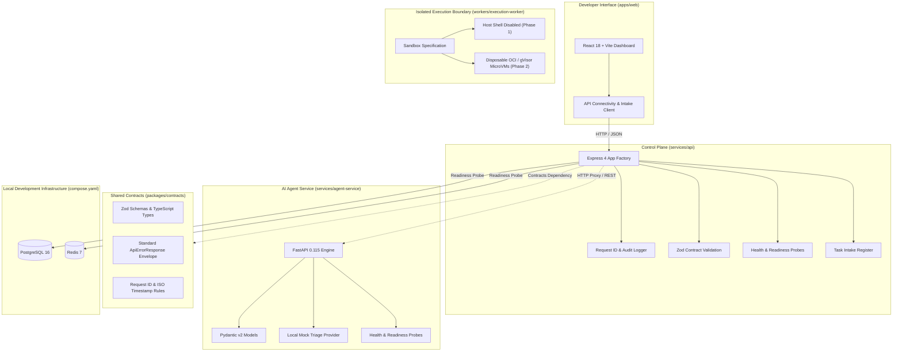

# Platform Architecture Specification (Phase 1)

## 1. System Topology & Architecture Overview

The Autonomous AI Software Engineering Platform is architected as a modular, contract-driven monorepo. Phase 1 establishes the communication boundaries, contracts, baseline development infrastructure, and isolated worker interfaces.



---

## 2. Service Boundaries

### 2.1 Web Frontend (`apps/web`)
- **Technology**: React 18, Vite 6, TypeScript, Tailwind CSS, Lucide icons.
- **Role**: Developer dashboard for workspace status, repository binding, task intake, and execution monitoring.
- **Security Boundary**: Runs completely in user browser without database credentials or master API tokens. Communicates exclusively via HTTP with `services/api`.

### 2.2 Main API (`services/api`)
- **Technology**: Node.js 24, Express 4, TypeScript, Zod.
- **Role**: Central coordinator and control plane.
- **Responsibilities**:
  - Request ID injection (`x-request-id`) across every inbound and outbound request.
  - Runtime validation using `@autonomous-engineer/contracts`.
  - Structured JSON logging with credential redaction.
  - Active probing of PostgreSQL and Redis infrastructure.
  - Modular routing with decoupled `createApp()` and `server.ts` to support unit and integration testing without binding ports.

### 2.3 AI Agent Service (`services/agent-service`)
- **Technology**: Python 3.12, FastAPI, Pydantic v2, Pytest.
- **Role**: Repository intelligence, code graph reasoning, and patch synthesis engine.
- **Phase 1 Status**: Modular skeleton with `/health`, `/ready`, and `/api/v1/analyze`. Operates with a local mock provider; **no paid LLM API key is required**.

### 2.4 Shared Contracts (`packages/contracts`)
- **Technology**: TypeScript, Zod.
- **Role**: Single source of truth for all network interfaces:
  - Request ID format and header definitions.
  - Unified error response envelope:
    ```typescript
    {
      success: false,
      error: {
        code: ErrorCode,
        message: string,
        details?: ValidationErrorDetail[],
        requestId?: string,
        timestamp: string
      }
    }
    ```
  - Health and readiness status structures with per-dependency statuses (`up`, `down`, `degraded`).

### 2.5 Execution Worker Boundary (`workers/execution-worker`)
- **Role**: Enforces zero-trust isolation around arbitrary code execution.
- **Phase 1 Invariant**: Arbitrary shell execution on the host machine is completely disabled.
- **Future Runtime**: Disposable OCI containers or gVisor microVMs with cgroup v2 resource quotas, network namespace egress filters, and unprivileged user mappings.

---

## 3. Communication and Data Flow

1. **Intake Flow**:
   User submits task via Frontend -> Payload validated by Zod schema -> Express assigns unique Request ID -> Task recorded in audit register -> 201 Created returned with execution metadata note.
2. **Probing Flow**:
   Frontend polls `/ready` -> Express attempts short-timeout connections to Postgres (`SELECT 1`) and Redis (`PING`) -> Express returns structured status map with latency in ms -> Frontend renders honest connectivity badge.
